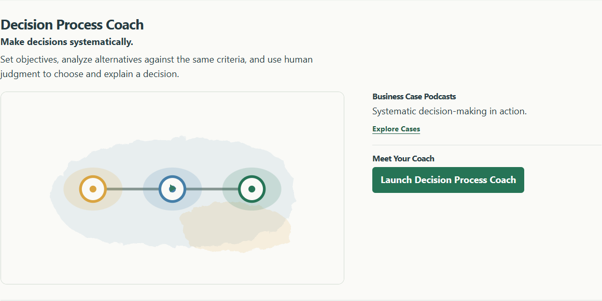
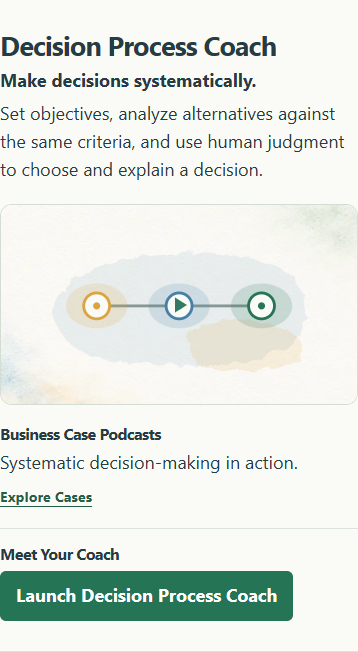

# Process Coach Alpha activation — 20 November 2026 (Central)

Process Alpha AI is ON for authenticated Students through the existing Administrator master. Explore has the green **Launch Decision Process Coach** link to `/process/`. Production is unchanged. Protected test sessions were signed out and the isolated browser closed.

- [Alpha Explore](https://d6owpirihdsus.cloudfront.net/explore)
- [Alpha Process Coach](https://d6owpirihdsus.cloudfront.net/process/)
- [Coordination issue](https://github.com/xiaominy2025/gpttutor-frontend/issues/11)
- [Release evidence](./evidence/alpha-activation-20261120/release-evidence.json)

## Deployed sources and resources

Deployed website source: `df70a6d704a03c82d687f6967d0f1b720ef28904` (implementation `9477a25`). This evidence commit changes documentation only. Tree live18 is `44defa7`. Process live6 is runtime `31ed7bb`, code `07YyCjaVUpeMPc1drHsEI3PHFeIcOAUflwgwZwZVqc0=`. Its operational reader/tests are at `3b9c426`. Platform BFF live5 remains unchanged. PRs remain draft; no merges.

Account `771049112957`, region `us-east-1`. Reused CloudFront `E1C4AJI9FUE47B`, bucket `decisiontree-alpha-staging-frontend-vnhhrwadnpad`, functions `engent-platform-alpha-api`, `decisiontree-alpha-staging-api`, `decisionprocess-alpha-api`, table `decisionprocess-alpha-usage` and dedicated SecureString `/decisionprocess-alpha/openai-api-key`. Its stored value/version was not changed. The only IAM delta was the reviewed projected GetItem grant on the Alpha master partition to the existing Process role; runtime fixes sort key STATE. No new table, dashboard, switch, credential or fixed-charge infrastructure.

Web release `process-alpha-launch-787fb40f-adbd-42e3-9fa7-ecfbcacd0e13` made three writes: one immutable JS, one conditional HTML replacement and one scoped invalidation. HTML version `CG8zJEaxZ0r8s8RRVyRyRc9bFmswtpzf`; completed invalidation `I59MZ7YOI0PI7CUFTL1AN3GSYU`. Shared edge configuration, other applications and existing assets were preserved.

## Verification and costs

149 frontend tests, 359 Tree tests, 249 Process offline tests and ten real DynamoDB cases passed. Real tests used isolated owned keys with conditional cleanup, never real-budget resets. Both hosted desktop/mobile checks passed: matching green launch button, navigation/refresh, Guest access and AI denial, Tree Guest access, homepage and actual podcast playback. No overflow or forwarded project writes.

Genuine existing Student email sign-in returned to Process and persisted after refresh. The published Explore launch preserved that session without another code. Process sign-out stayed on Process, revoked participating sessions/tabs and produced protected API401 responses. Administrator MFA remains ON. Administrator logout left the independent Student session valid. No accounts were created, upgraded or deleted; entitlements and projects were preserved.

Acceptance exposed three defects, now fixed with regression coverage: reserved `metrics` needed a DynamoDB settlement alias; the credential reader needed to unwrap the existing single-field JSON envelope instead of sending pretty JSON as an HTTP header; reserved `locks` needed an alias in the read-only receipt projection. The last correction required no runtime redeployment or paid replay.

One genuine hosted analysis succeeded: 1,500 input and1,864 output tokens. Conservative metered accounting is **$0.0011195**. The earlier failed transport retains a **$0.00526975** server hold; total accounting charge/hold is **$0.00638925**. Both stopped local ledgers remain intact, conservatively reserving **$0.064** within the approved **$0.20** cap. Three planned slots were not run. This is one validated interaction with authoritative read-only receipt reconciliation, not a completed five-success suite. No further paid requests were made to finish a test list. These amounts are accounting estimates, not a provider invoice.

Master ON revision9 and Process flags true/true were verified with a genuine Student status response. Guest AI remains denied. Existing authentication, credential, per-dispatch master checks and limits remain: $10/month global, $1/day global, $0.50/user/day,50 starts/user/day,6/minute,1/user and3/global concurrent. Lambda reserved concurrency3 and timeout80seconds are unchanged. Normal existing-service usage charges apply; no new fixed monthly infrastructure charge.

## Rollback and limitations

For an AI incident, use the existing MFA Administrator control to pause paid AI, capture the fresh revision and drain admitted work. CAS Process live6 to retained credential-fixed AI-OFF version5 and restore only the two owned latest environment flags with fresh revision checks. Preserve all versions, usage records and unknown holds. Actual flag rollback4 to3 was exercised successfully; the current5/6 guard has eight passing tests. Never blindly replay an old manifest after master revisions change.

Website rollback conditionally restores captured original HTML version `.mLQlLouvfnyozMnVrkEROMGqjAgqPwc` only when current version/ETag/release marker proves ownership, then performs scoped invalidation. Keep immutable assets. No destructive sync or full CloudFront configuration restore. Publication guard review passed14 fixtures and2 crash-window checks. Do not return Tree to17 while claiming per-dispatch master enforcement with master ON.

A hard Lambda termination can leave a fail-closed concurrency slot held. Manual orphan recovery requires positive terminated-invocation evidence and a drained window; unknown spending holds must not be refunded. Controlled timeout/unknown-commit behavior was tested; a live hard kill was not forced. Document current direct-release version/environment state before any future CloudFormation update. Production publication remains a separate approval.

## Guest screenshots

