# Release B corrected source and Alpha approval package

Supersedes the Explore-only logout description in earlier versions of this file. Authoritative direction: Issue 13 and Issue 11 comments 7019991212 / 7020681012. Continue frontend PR12 and Tree PR16, same codex/issue-11-email-bridge branches. Superseded PR10/Tree15 are excluded. No deployment, IAM/Cognito/DNS/user changes or merge occurred.

## Source result and state machine

See engent-header-session-contract-v1.md for the reusable UI/behavior contract, included identically in both repositories. Homepage/Explore/cases and Tree landing/workspace now render a single locally bundled compact header under VITE_RELEASE_B_EMAIL_ENABLED. Original media, podcasts, Guest access and project toolbar/map remain. Native details/summary account menu is keyboard accessible; scoped CSS avoids legacy global header height/max-width/button rules.

```mermaid
stateDiagram-v2
 [*] --> Guest
 Guest --> EmailChallenge: explicit email submission
 EmailChallenge --> Guest: failed/consumed code; explicit retry only
 EmailChallenge --> RootActive: original verified email + permitted Student admission
 RootActive --> PendingWrapper: verified credential only; no protected access
 PendingWrapper --> TreeActive: browser account confirmation + atomic activation/consume
 TreeActive --> Revoked: sign out in either header
 PendingWrapper --> Guest: cancel or ten-minute expiry
 RootActive --> Revoked: expiry/suspension/revocation checks
 Revoked --> Guest: protected APIs deny; tabs refresh on focus/30s
 Guest --> EmailChallenge: explicit new sign-in
```

A verified root is first pending and cannot access protected APIs. Every new sign-in confirms the target browser context before atomic lease activation, even when returning to Home/Explore; this prevents two different active app identities during cutover. Wrong-account recovery retains pending status, does not request a second code, and cannot silently clear an active B account. Root SESSION is the shared authority; derive the opaque lease from its random root instead of adding a registry. Actual root metadata caps all deadlines. Every protected Tree API is gated, not a fixed list that a future endpoint could bypass; public health/logout and separate Admin endpoints remain explicit exceptions. B enabled suppresses old A session fallback even with B cookies cleared. Successful join retires prior same-subject native/OAuth browser sessions; wrong-account attempts fail. Original backend session revoke/conditional refresh is reused. No global Cognito subject/device signout, copied refresh token, new identity store or broad cookie Domain.

Header logout first revokes the current root, then local cleanup; errors stay incomplete rather than falsely successful. A request already authorized before root deletion is not claimed to be cancelled, but next protected authorization fails immediately, without waiting for polling. Other devices and Admin MFA are preserved. Direct Coach entry points at the fixed Explore email form and return intent; verification starts a fresh short handoff, never a second code. A fallback is available by restoring flag OFF plus retained A artifacts; it is not silently retried after a B logout.

## Source/local evidence

Issue 11 records final source pins, tests and clean build receipts. Tests exercise both real adapters in headless Chrome over two HTTPS sibling fixture hosts, with a locally generated self-signed certificate and no public network access. New/returning synthetic code flows, logout in both applications, immediate protected API denial in other tabs, old native/OAuth-cookie denial, another browser context remaining signed in, state/expiry/replay/races and partial failures are covered. This is not proof of live Cognito email, real AWS TLS/edge or user canary behavior.

Actual built homepage, Explore, podcast page, Tree landing and Guest workspace are reviewed at 1440x1000 and 390x844, including menu keyboard/Escape, role changes and failed sign-out UI. Screenshots contain only synthetic/Guest content. Full-page website captures enlarge the local fixture viewport to the nested scroll extent; this is capture-only, not product CSS. Original media files/components were not edited. Both header source files compare byte-for-byte between repos. Server flags default OFF and separate local enabled/OFF artifacts retain A receipts.

## Read-only Alpha inventory (Nov 19, 2026)

Account 771049112957/us-east-1. BFF engent-platform-alpha-api:live=1 and Tree decisiontree-alpha-staging-api:live=11; SHARED_AUTH_ENABLED=false, B flag absent. BFF runtime engent-platform-alpha-runtime has no boundary; Tree role decisiontree-alpha-staging-ApiRole-tmQtkTYts533 uses decisiontree-alpha-staging-runtime-boundary default v2. Original tables/roles preserved.

API 8qmgd1ghdi has only public proxy->Tree integration1xwneaq, platform proxy->pnnbk27, and IAM entitlements->1xwneaq. No proposed email routes exist. Existing BFF policy grants only old entitlements Invoke. Current simulator denies the new Invoke and root ConditionCheckItem; root DeleteItem is already allowed. Current boundary also lacks SHARED deletion, despite an existing inline A shared-delete grant.

Distribution E1C4AJI9FUE47B / d6owpirihdsus.cloudfront.net: API POST methods already forwarded; Managed-CachingDisabled TTL=0; Managed-AllViewerExceptHostHeader forwards Origin/cookies/query. Access logs and CloudFront logging are disabled in this Alpha configuration (configuration read only, no visitor logs read). Existing engent-release-a-alpha-explore viewer function is preserved; its exact ETag/source was captured locally. Existing versioned artifact bucket decisiontree-alpha-artifacts-771049112957-us-east-1 is available. Student pool us-east-1_CipTwwDZb remains ESSENTIALS, MFA OFF, AdminCreateUserOnly=true, LambdaConfig empty. No Alpha registration guard function, role or boundary exists. Its 14-day log group is retained and must be reused; creating it again would collide. Available Lambda concurrency is 981 unreserved of 1000; a guard reserve of5 needs no quota increase.

Proposed role+boundary simulations allow exact root/lease ConditionCheckItem and required deletion; handoff ConditionCheckItem remains denied; five exact Alpha Invoke resources are allowed while the production API remains denied. Resource-specific results matter: the simulator aggregate is implicitDeny when the negative-control production resource is included. No policies were applied. Simulation is not an actual signed gateway call and does not prove all organization/network controls.

## Exact Alpha-only proposed change set (NOT executed)

1. Five AWS_IAM email routes on existing API8qmgd1ghdi, integration1xwneaq, plus two attached inline policies: infra/release-b/alpha-routes.template.json (7 resources). BFF Invoke only /internal/platform/email/{start,finish,session,handoff,advanced-request}. Tree ConditionCheckItem only SESSION#* and SHARED#EMAIL-LEASE#*. Add Alpha DeleteItem only email lease/handoff and SHARED#SESSION#* (legacy OAuth retirement) to role and effective boundary. Preserve every existing grant; no new BFF boundary is needed because none is attached. Append to the existing Tree v2 boundary using a new policy version, never overwrite/delete old versions without review.
2. Existing Lambdas: publish immutable B versions and move only Alpha aliases after approval. Initial OFF candidate retains captured shared-auth OFF baseline. Enabled candidate sets B true and existing shared-auth true so legacy OAuth cookies can be verified/retired internally; legacy public login endpoints still remain blocked by B. Production remains untouched. Capture/restore all other environment values and roles; no secret reads/updates by deployment preparation.
3. Existing Alpha S3/CloudFront: upload versioned, immutable B artifacts to Alpha-only paths. Repoint only the existing Explore and Tree frontend origin paths to their approved artifacts; retain old paths. Preserve all cache behaviors, methods, policies and distributions. Update the existing Alpha viewer function with alpha-explore-function.js solely to serve /engent-alpha/ as the homepage preview; / remains Tree. Routes /explore and /explore/{coach}/cases stay in existing routing. No new domain/certificate/distribution/bucket or destructive S3 sync.
4. First-time canary requires the existing source template infra/security/registration-guard-release-b-alpha.template.json in Tree: 6 NEW temporary Alpha resources (managed boundary, role, Lambda256MB arm64/4s/reserved5, version, alias, exact pool invoke permission). Reuse the existing /aws/lambda/engent-release-a-alpha-registration log group with its unchanged14-day retention; the new template does not own/delete it. Artifact bucket is the existing versioned Alpha bucket, not production. Attach canary-only guard while pool self-signup remains closed, validate original-client/email-digest/pause enforcement, then temporarily open Alpha admission and application registration only for the specifically approved canary. Restore admission closed BEFORE detaching guard. No public/client signup weakening or production pool change. Canary email digest is NoEcho and never committed/published. This guard was absent in inventory, so the bounded approval must explicitly include it.

Total proposed new Alpha stack resources: 13 across route/policy and temporary canary guard templates, plus versions of existing app Lambdas, one boundary version, existing alias/environment/edge-origin/function updates, and bounded temporary Alpha pool/config changes. No new application identity store. Actual AWS-generated unexecuted change sets, exact artifact hashes/version IDs and final config diffs must be produced after appropriate bounded execution-preparation approval, not fabricated here. Stop on inventory drift or policy-version quota; do not delete old policy versions automatically.

## One bounded Alpha acceptance / rollback proposal

Authorize once for the above exact Alpha scope and designated accounts: existing Student/Advanced login/read-only entitlement checks, one explicit first-time disposable canary creation/confirmation/default Student membership and conditional cleanup, one disposable Student Advanced request only if separately included, and temporary canary guard/admission switch changes with mandatory restoration. Previous account permissions are not presumed transferable. No project writes, paid AI or arbitrary entitlement changes; protect browser before opening Tree. Admin MFA uses existing designated account with manual code entry, no code in chat/evidence.

Acceptance: first-time and returning use one real email/code; direct visits/refresh; Student/Advanced preserved; separate Admin MFA; desktop/mobile/keyboard; signout from both headers across tabs, new protected API denial before visual refresh, unrelated browser/device stays signed in; wrong-account/referrer/CSP/CSRF/replay/races; actual root deadline; bounded failed-code retry; old-cookie suppression; original fallback and rollback. Public Alpha TLS and actual signed gateway/IAM behavior must be tested, not inferred from fixtures. Keep production A ON.

Capture original alias versions1/11/flags, CF full config+fresh ETags, origin paths, viewer source, role/boundary documents/version IDs and pool LambdaConfig/admission/registration settings before execution. On failure: disable B and restore actual A frontend artifacts/aliases/flags and exact edge config; restore Alpha admission/registration FIRST, then detach/remove only bounded canary resources. Remove only B routes/inline policies/boundary statements through reviewed rollback. Retain all unrelated users, members, projects, A OAuth clients/guard and production resources. Newly-created canary cleanup is conditional on proof of ownership/no existing data. Live B Alpha rollback has not been performed.

## Costs

Bridge has no new fixed monthly service charge; temporary guard is on-demand Lambda/DynamoDB/log usage, not provisioned capacity. Authenticated visible tabs poll at most every30s, Guest tabs only on initial/focus/visibility. Ten authenticated tabs open2h/day for30days yield about72,000 status checks before focus/login overhead, about144,000 HTTP API/Lambda invocations for BFF->Tree, plus strong table reads/provider checks. Example budget allowance $1-3/month incremental at this small load, excluding existing baseline, Cognito MAUs/email, taxes, abuse and storage/log variation; not a cap or measured bill. Actual Tree memory is512MB arm64 and BFF uses its existing configuration. No paid AI path, WAF, NAT, new pool/table, WebSockets or additional monitoring subscription. Verify canary duration and request volume before production. Sources: https://aws.amazon.com/api-gateway/pricing/ ; https://aws.amazon.com/lambda/pricing/ ; https://aws.amazon.com/dynamodb/pricing/ .

## Issue 13 conformance and remaining gates

1. Header: implemented on Home/Explore/cases/Tree landing+workspace, locally bundled same1.0.0 contract. Desktop/mobile/keyboard source evidence; live Alpha pending.
2. Two-choice one-code journey: implemented using original SDK path, explicit retry; fixtures/SDK mocks pass. Real designated first-time/returning canary pending.
3. Central identity/session: one native root and derived pending-to-active lease, actual deadline caps, backend gate and native-cookie isolation. Mock races pass; effective signed Alpha execution pending.
4. Coordinated signout: implemented (old local-logout behavior removed), both-header/multitab/root denial/other-device/partial failure tests. Live Alpha acceptance remains a release blocker, not deferred B2.
5. Coach authorization: backend Tree-specific role/request semantics preserved; UI labels explicit. Live checks pending; no global Advanced or Admin MFA change.
6. Independent deploy: pinned source contract, existing APIs/stacks, no remote runtime dependency. Future coaches integrate only when released; none created now.
7. Preservation/safety: original auth/session/account/Admin/project implementations and all artwork/audio remain; new entry wrappers and conditional header UI only. A production stays public ON, drafts unmerged. Rollback uses retained immutable A artifacts.

Temporary deviation: published A intentionally keeps old auth/header semantics until approved B cutover; retirement trigger is successful B Alpha then production acceptance. Newly rebuilt OFF assets are regression candidates, not claimed byte-identical A files. Administrative console remains separately authenticated; its MFA interface is not converted into a Student account menu. No production readiness claim until live gates and independent source review pass.

## Local acceptance evidence (2026-11-19)

Frontend: 100 tests across 24 files passed. Tree: 326 tests across 56 files passed using direct Vitest invocation with maxWorkers=2 and testTimeout=30000; npm did not forward those options. Earlier sandbox runs failed loopback connections; early cold-import runs exceeded the default five seconds. No product timeouts or assertions were weakened.

Both desktop and mobile test-release-b-browser.mjs runs passed against real B adapters and synthetic providers/stores over local HTTPS sibling hosts. review-release-b-pages.mjs passed actual built-page header/navigation/Guest/keyboard/overflow assertions. TypeScript passes as part of Tree packaging. Frontend Alpha enabled and production OFF local builds pass. No live authentication, signed gateway call, registration, paid AI or rollback was performed.

Screenshots in docs/evidence: release-b-home-desktop.png, release-b-explore-mobile.png, release-b-tree-workspace-desktop.png, release-b-header-advanced-mobile.png. The Advanced screenshot intentionally demonstrates a mocked partial logout failure; it is not a real account or incident. Header JSX/CSS parity is asserted across repositories. Exact source commits and clean artifact receipts are recorded in Issue 11 after committing.

## Independent review correction follow-up

See release-b-alpha-final-gate.md for the six-point disposition, exact operator policy, canary designation requirements and a single stop-on-failure execution/rollback rehearsal proposal. Original persistent root revoke is already idempotent. Missing leases now produce an idempotent participating-browser result; revoked Explore wrapper mappings remain TTL-bound for lost-response retry instead of being deleted. This cannot authenticate a revoked root. Legacy cutover may require fresh original sign-in after rollback; revoked tokens are never restored. Broad API exemptions are replaced by exact audited methods; all legacy auth/shared namespaces remain disabled while B is enabled.

No live acceptance or infrastructure execution authorized by this correction. The prior local evidence remains identified by its commit; latest exact test totals/build source pins are in Issue11.
